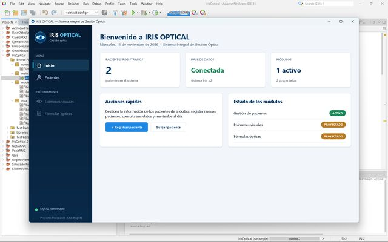
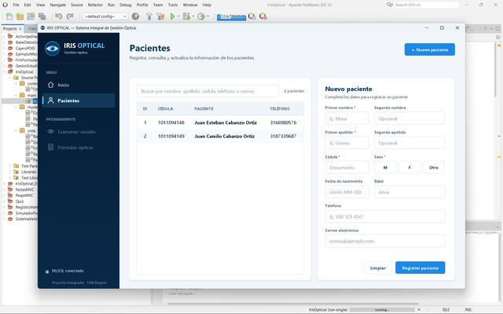

# IRIS OPTICAL – Sistema Integral de Gestión Óptica

Donde la gestión óptica se ve con claridad. IRIS OPTICAL reúne la información de la atención visual en un solo lugar, para que administrarla sea más simple y organizado.

**Proyecto Integrador** · Tecnología en Desarrollo de Software · Universidad de San Buenaventura Bogotá · Tercer semestre

**Autor:** Juan Esteban Cabanzo Ortiz · [jecabanzoo@academia.usbbog.edu.co](mailto:jecabanzoo@academia.usbbog.edu.co)

**Página del proyecto:** https://juanescabanzo.github.io/Iris_Optical/



## Descripción

IRIS OPTICAL es una aplicación de escritorio hecha en Java que se conecta a una base de datos MySQL. Permite organizar y administrar la información de los pacientes de una óptica: registrarlos, buscarlos, actualizar sus datos y eliminarlos.

El proyecto se va construyendo por etapas a lo largo de la tecnología. Por eso este README diferencia entre lo que **ya funciona** y lo que está **proyectado** para los siguientes semestres.

> El proyecto se llamó antes Iris SGM y era un sistema biométrico. Esa idea se cambió y hoy es solo de gestión óptica, por eso algunos archivos internos pueden conservar el nombre anterior.

## Objetivo

Desarrollar un sistema de gestión óptica que permita organizar y administrar la información de los pacientes y de los procesos de la atención visual, con una aplicación de escritorio en Java conectada a MySQL, para mejorar la organización, la consulta y el manejo de la información de una óptica.

## Estado actual

| Funcionalidad | Estado |
|---|---|
| Registrar, consultar, buscar, actualizar y eliminar pacientes | Implementado |
| Validación de datos y mensajes de error claros | Implementado |
| Cálculo automático de la edad | Implementado |
| Panel de inicio con indicadores y estado de la conexión | Implementado |
| Auditoría automática con triggers de MySQL | Implementado |
| Procedimiento almacenado de búsqueda por cédula | Implementado (en la base de datos) |
| Citas y especialistas | Proyectado |
| Exámenes visuales y fórmulas ópticas | Proyectado |
| Diagnósticos e historias clínicas | Proyectado |
| Inicio de sesión, roles y permisos | Proyectado |
| Reportes | Proyectado |
| Plataforma web | Proyectado |

Algunas de las tablas de los módulos proyectados ya existen en la base de datos, pero todavía no tienen pantallas en la aplicación.

## Tecnologías

| Tecnología | Uso |
|---|---|
| Java 21 | Lenguaje de programación |
| Java Swing | Interfaz gráfica |
| MySQL 8.0 | Base de datos |
| JDBC (MySQL Connector/J 8.0.12) | Conexión entre Java y MySQL |
| Apache NetBeans | Entorno de desarrollo |
| MySQL Workbench | Administración de la base de datos |
| HTML y CSS | Página del proyecto |

## Arquitectura

El sistema usa el patrón **Modelo-Vista-Controlador (MVC)** junto con **DAO** para el acceso a los datos:

**Vista → Controlador → Modelo / DAO → Conexión JDBC → MySQL**

| Capa | Paquete | Clases |
|---|---|---|
| Vista | `src/vista` | `FrmPrincipal`, `BarraLateral`, `PanelInicio`, `PanelPacientes`, `Estilo` |
| Controlador | `src/controlador` | `CtrlPaciente` |
| Modelo | `src/modelo` | `Paciente`, `PacienteDAO`, `Conexion` |
| Punto de entrada | `src/main` | `AppMain` |

## Estructura del repositorio

```
Iris_Optical/
├── src/                  Código fuente en MVC
│   ├── main/             AppMain
│   ├── modelo/           Paciente, PacienteDAO, Conexion
│   ├── vista/            Ventanas y paneles (Swing)
│   └── controlador/      CtrlPaciente
├── lib/                  Driver de MySQL (Connector/J)
├── database/             Script SQL de la base de datos
├── ejecutable/           Programa listo para usar (IrisOptical.jar)
├── documentacion/        Documentos en Word, diagramas y evidencias
├── docs/                 Página web del proyecto (GitHub Pages)
├── nbproject/, build.xml Configuración del proyecto en NetBeans
└── README.md
```

## Cómo usar el programa

### Qué necesitas

- **Java 21** o superior instalado.
- **MySQL 8.0** instalado y funcionando (con MySQL Workbench es más fácil).

### Pasos

1. **Descarga el repositorio.** En esta página pulsa el botón verde **Code → Download ZIP** y descomprime el archivo. También puedes clonarlo:
   ```
   git clone https://github.com/JuanesCabanzo/Iris_Optical.git
   ```
2. **Crea la base de datos.** Abre MySQL Workbench, entra en **File → Open SQL Script**, elige `database/Script_Iris_Optical.sql` y pulsa el rayo para ejecutarlo. Este script crea la base `sistema_iris_v2` con sus tablas, triggers y el procedimiento almacenado.
   > Ojo: el script borra la base `sistema_iris_v2` si ya existe y la crea de nuevo.
3. **Revisa la conexión.** Por defecto el programa usa el usuario `root` con la contraseña `root`. Si tu MySQL tiene otra contraseña, copia `ejecutable/db.properties.example` como `ejecutable/db.properties` y escribe ahí tus datos.
4. **Ejecuta el programa.** Entra a la carpeta `ejecutable` y haz doble clic en **`EJECUTAR.bat`**. También puedes abrir una consola en esa carpeta y escribir `java -jar IrisOptical.jar`.

Si abajo a la izquierda de la ventana dice **MySQL conectado**, todo está funcionando. Si dice "Sin conexión a MySQL", revisa que MySQL esté encendido y que los datos del paso 3 sean correctos.

### Abrirlo en NetBeans

1. En NetBeans: **File → Open Project** y elige la carpeta del repositorio.
2. Clic derecho en el proyecto → **Clean and Build**.
3. Clic derecho → **Run**.

El driver de MySQL ya viene dentro de `lib/`, no hace falta descargarlo.

## Qué puedes hacer en la aplicación

- **Inicio:** ver cuántos pacientes hay registrados y si la base de datos está conectada.
- **Registrar** un paciente con el formulario. Los campos con `*` son obligatorios.
- **Buscar** pacientes escribiendo en el buscador: por nombre, apellido, cédula, teléfono o correo.
- **Actualizar** un paciente: haz clic en su fila, cambia los datos y guarda.
- **Eliminar** un paciente, con confirmación antes de hacerlo.



## Base de datos

La base `sistema_iris_v2` tiene 8 tablas: `Paciente`, `Especialista`, `Cita`, `Examen_Visual`, `Formula_Optica`, `Diagnostico`, `Historia_Clinica` y `Auditoria`. Solo `Paciente` se usa desde la aplicación por ahora.

- **Triggers:** 21 triggers de auditoría guardan en la tabla `Auditoria` cada inserción, actualización y eliminación.
- **Procedimiento almacenado:** `sp_buscar_paciente_por_cedula` devuelve los datos de un paciente a partir de su cédula.

```sql
CALL sp_buscar_paciente_por_cedula('1020304050');
```

## Documentación

Los documentos del proyecto se pueden leer en la página del proyecto o abrir desde aquí:

- [Especificación de requisitos de software (IEEE 830)](docs/docs/IRIS_OPTICAL_IEEE_830.pdf)
- [Documentación de Scrum](docs/docs/IRIS_OPTICAL_Documentacion_Scrum.pdf)
- [Diagramas UML y de arquitectura](documentacion/Diagramas_IRIS_OPTICAL) (casos de uso, clases, actividades, estados y arquitectura MVC)
- [Pruebas y evidencias de funcionamiento](documentacion/Evidencia%20Funcionamiento%20Proyecto)
- [Documentos en Word](documentacion/Documentacion%20Proyecto)

## Página del proyecto

La página web del proyecto está en la carpeta `docs/` y se publica con GitHub Pages. Reúne la descripción, la arquitectura, las funcionalidades, la documentación y las evidencias.

## Próximos pasos

En los siguientes semestres se desarrollarán los módulos proyectados: especialistas, citas, exámenes visuales, fórmulas ópticas, diagnósticos, historias clínicas, inicio de sesión con roles, reportes y una versión como plataforma web.

## Autor

**Juan Esteban Cabanzo Ortiz**
Tecnología en Desarrollo de Software · Universidad de San Buenaventura Bogotá
[jecabanzoo@academia.usbbog.edu.co](mailto:jecabanzoo@academia.usbbog.edu.co)
